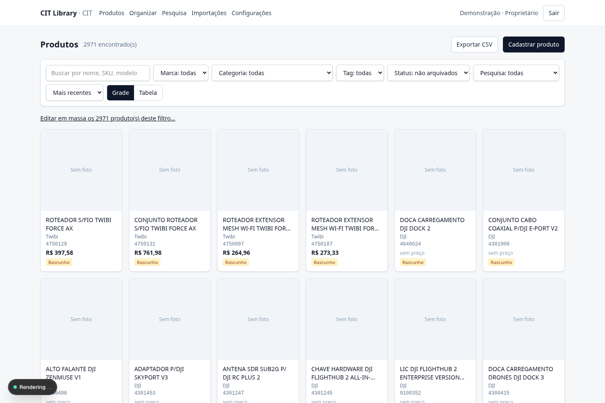

# CIT Library

Biblioteca interna de produtos (Next.js 16 + PostgreSQL 17 + Prisma 7 + Better Auth).
Estado por fase: [docs/status.md](docs/status.md). Especificação: [CLAUDE.md](CLAUDE.md).
Migrar para outro computador: [docs/migracao.md](docs/migracao.md) · Pesquisa e preços: [docs/pesquisa.md](docs/pesquisa.md) · API para outros sistemas: [docs/api.md](docs/api.md) · Importação: [docs/importacao-intelbras.md](docs/importacao-intelbras.md).

## Telas do aplicativo

Capturas reais da aplicação em execução. [Ver login, catálogo e produto](telas/README.md).



## Para usar no dia a dia (este Mac)

```bash
npm run db:local:start   # banco
npm run dev              # app em http://localhost:3000
npm run worker           # em outro terminal: importações e pesquisas
```

## Pré-requisitos

- Node.js 22.23.3 (`.nvmrc`). Neste Mac foi instalado em `~/.local/node` (PATH em `~/.zprofile`).
- PostgreSQL 17: **ou** Docker Desktop (`docker compose up -d db`), **ou** binários locais com `PG_BIN` no `.env` (`npm run db:local:start` / `db:local:stop` / `db:local:status`). Este Mac usa a segunda opção.
- Git.

## Instalação do zero (Mac servidor)

```bash
npm ci
npm run env:init         # gera .env com senhas aleatórias (ou: -- --local-pg)
# POSTGRES_PASSWORD deve ser igual à senha em MIGRATION_DATABASE_URL;
# APP_DB_PASSWORD deve ser igual à senha em DATABASE_URL.
docker compose up -d db
npm run db:deploy        # migrações + papel restrito cit_app
npm run bootstrap        # cria organização e primeiro proprietário (senha sem eco)
npm run db:seed          # opcional: marca Intelbras (nenhum produto)
npm run build
npm start                # http://localhost:3000 (somente este Mac)
```

Para outros Macs da rede: `HOST=0.0.0.0 npm start` e configure a URL canônica — veja [docs/rede-local.md](docs/rede-local.md).

## Desenvolvimento

```bash
npm run dev              # localhost
npm run dev:lan          # 0.0.0.0, para testar de outro Mac (somente rede confiável)
npm run db:migrate       # nova migração (banco local de desenvolvimento apenas)
```

## Comandos

| Comando | O que faz |
|---|---|
| `npm run lint` / `npm run typecheck` | ESLint / tipos de rota + `tsc --noEmit` |
| `npm test` | Testes unitários (sem banco) |
| `npm run test:integration` | Recria `cit_library_test`, migra e testa contra PostgreSQL real |
| `npm run test:e2e:setup` | Recria banco `*_test`, mídia de teste e usuário de teste (`.env.test`) |
| `npm run test:e2e` | Playwright contra o build, só no ambiente de teste |
| `npm run db:local:start` / `stop` / `status` | PostgreSQL local sem Docker (`PG_BIN`) |
| `npm run db:generate` / `db:deploy` / `db:seed` | Prisma generate / migrate deploy + grants / seed idempotente |
| `npm run bootstrap` | Primeiro proprietário; não altera dono existente |
| `npm run user:reset-password` | Redefine senha localmente (sem SMTP), revoga sessões, audita |
| `npm run backup` | Banco + mídias + manifesto em `BACKUP_ROOT` |
| `npm run restore -- --manifest CAMINHO --target BANCO_NOVO` | Restaura em banco novo, nunca sobrescreve |
| `npm run media:reconcile -- --dry-run` | Lista inconsistências de mídia (`--apply` corrige após carência) |
| `npm run worker` | Worker persistente: aplica importações e executa pesquisas (deixe rodando) |
| `npm run import:catalog -- --file … --supplier … --as email` | Importação por linha de comando (prévia → `--confirm ID --effective-date`) |
| `npm run research -- --skus … --providers … --max-calls N --max-cost R$ --as email` | Pesquisa por linha de comando (ver docs/pesquisa.md) |

**Nunca** use `prisma migrate reset`, `prisma db push` ou `docker compose down -v` com dados reais.

## Onde ficam os dados

- Banco: `./var/pgdata` (PostgreSQL local) ou volume Docker `cit-library_cit_pgdata`.
- Fotos: `MEDIA_ROOT` (padrão `./var/media`), privado, fora do Git.
- Backups: `BACKUP_ROOT` (padrão `./var/backups`). Copie para fora do Mac servidor (ver docs/backup-restauracao.md).

## Primeiro acesso e convites

Não há cadastro público nem senha padrão. O primeiro proprietário é criado por `npm run bootstrap`.
Demais pessoas: **Configurações → Convidar pessoa**. Sem SMTP, o link aparece uma vez; envie por canal confiável.
