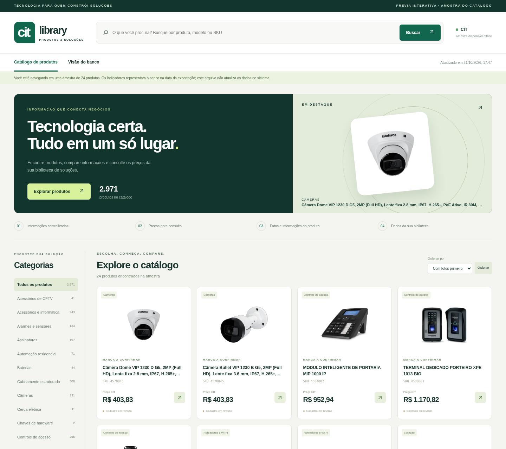
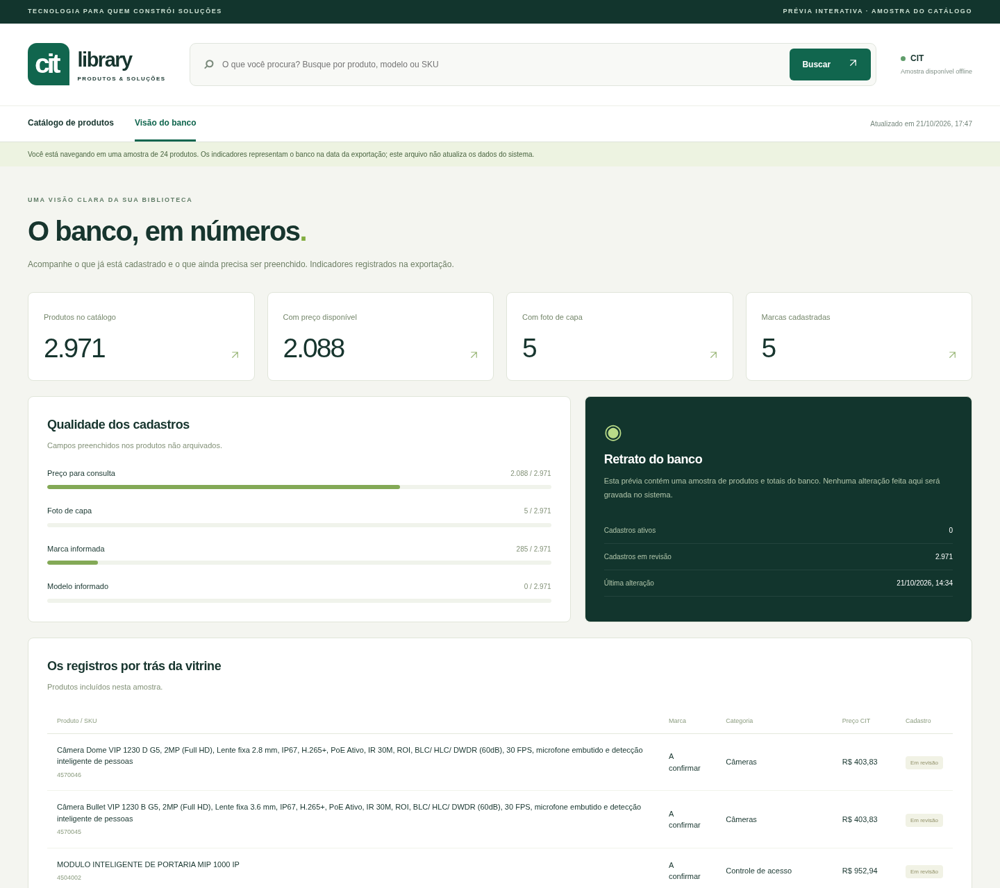

# Telas da CIT Library

Capturas da aplicação e da prévia de consulta em 21/10/2026. Custos internos, credenciais e dados pessoais não fazem parte destas capturas.

## Catálogo interativo

[**Baixar o catálogo interativo (.zip)**](https://github.com/citiasolutionsportaonet-sketch/CIT_library/raw/refs/heads/main/telas/catalogo-distribuidora.zip). Extraia e abra **catalogo.html** no Chrome. A prévia oferece busca, filtros e detalhes de uma amostra de 24 produtos, além dos indicadores do banco na data da exportação. Não grava alterações no sistema. As fotos são as já existentes na biblioteca.

## Visão do banco

## Login

## Catálogo de produtos

## Detalhe do produto

